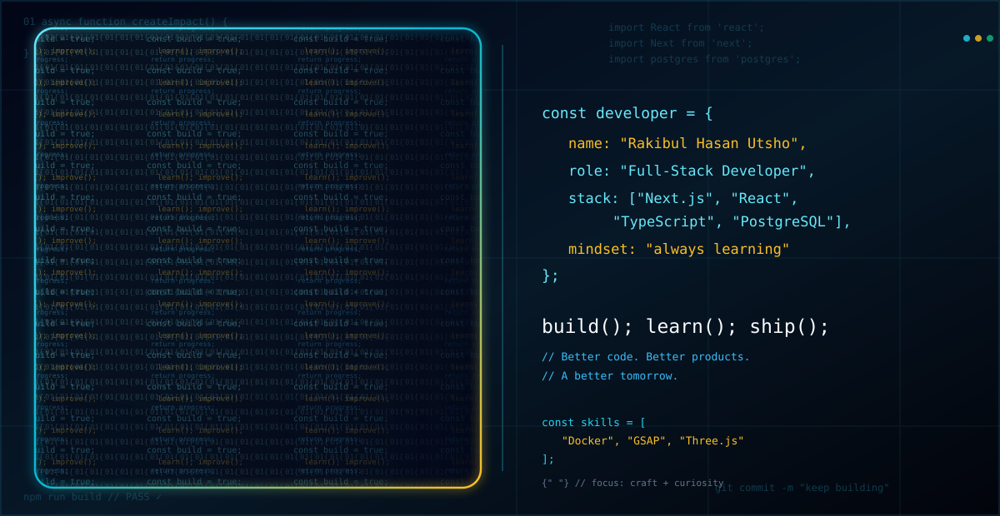

<!-- Animated profile header -->

  

  

  

  
  

---

## 👨‍💻 About me

I'm **Rakibul Hasan Utsho**, a full-stack web developer who enjoys turning ideas into useful, reliable web products. I mainly build with the **JavaScript/TypeScript ecosystem**, from modern React interfaces to API- and database-backed applications.

- ⚡ **Frontend:** React, Next.js, TypeScript, Tailwind CSS, shadcn/ui and component-driven interfaces.
- 🧩 **Backend:** Node.js, Express, REST APIs, validation, authentication and background jobs.
- 🗄️ **Data:** MongoDB/Mongoose and PostgreSQL; exploring Redis-backed queues and reliable data flows through projects.
- 🎞️ **Motion & UX:** Motion/Framer Motion and GSAP for purposeful interface animation.
- 🧪 **Engineering quality:** Type checking, automated tests, linting and production build checks.
- 🌱 **Mindset:** Learn by building, improve continuously, and write maintainable code.

  

## 🧰 Tech stack

  

  
  
  
  
  
  
  
  
  
  
  

### 📚 Learning by building

These are technologies and practices I'm exploring through projects—not a claim that I've mastered every tool:

- **Modern full-stack patterns:** Next.js, React, TypeScript and reusable UI systems.
- **Data and asynchronous work:** PostgreSQL, Redis and BullMQ alongside MongoDB-backed APIs.
- **Authentication and application security:** passkeys/WebAuthn, session flows and safer API design.
- **Interactive UI and 3D:** Motion/Framer Motion, GSAP, Three.js and QR-based experiences.
- **Developer tooling:** Docker for reproducible development environments and container workflows.
- **Engineering discipline:** automated tests, type checking, linting and production build validation.

---

## 🚀 Selected projects

| Project | What it explores | Repository |
| :--- | :--- | :--- |
| **FactoryOS** | Manufacturing, inventory and production workflows, with a focus on traceability and reliable APIs. | [Open repo](https://github.com/RakibulhasanUtsho07/factoryos) |
| **Digital Wallet Backend** | TypeScript API services, authentication, validation and asynchronous job processing. | [Open repo](https://github.com/RakibulhasanUtsho07/digital-wallet-backend) |
| **Digital Payment System Web** | Next.js UI, passkey-ready authentication, QR flows and motion-rich experiences. | [Open repo](https://github.com/RakibulhasanUtsho07/digital--payment-system-web) |
| **Job Tracker Web** | Job tracking with a PostgreSQL-backed foundation and application quality checks. | [Open repo](https://github.com/RakibulhasanUtsho07/job-tracker-web) |
| **3D Geospatial Platform** | 3D geospatial data workflows, viewport performance and interactive visualization. | [Open repo](https://github.com/RakibulhasanUtsho07/3d-geospatial-platform) |
| **TimeTorol — Next.js** | A modern React/Next.js application using TypeScript and UI motion. | [Open repo](https://github.com/RakibulhasanUtsho07/timetorol_next) |

  

---

## 📊 GitHub activity

  
  

  

  

### 🐍 Contribution snake animation

  <picture>
    <source media="(prefers-color-scheme: dark)" srcset="https://raw.githubusercontent.com/RakibulhasanUtsho07/RakibulhasanUtsho07/output/github-contribution-grid-snake-dark.svg" />
    <source media="(prefers-color-scheme: light)" srcset="https://raw.githubusercontent.com/RakibulhasanUtsho07/RakibulhasanUtsho07/output/github-contribution-grid-snake.svg" />
    
  </picture>

> The snake animation appears after the included GitHub Actions workflow completes successfully for the first time.

---

## 🤝 Connect with me

  
  
  
  

<em>“Keep learning, keep building, and make every commit count.”</em>

  

