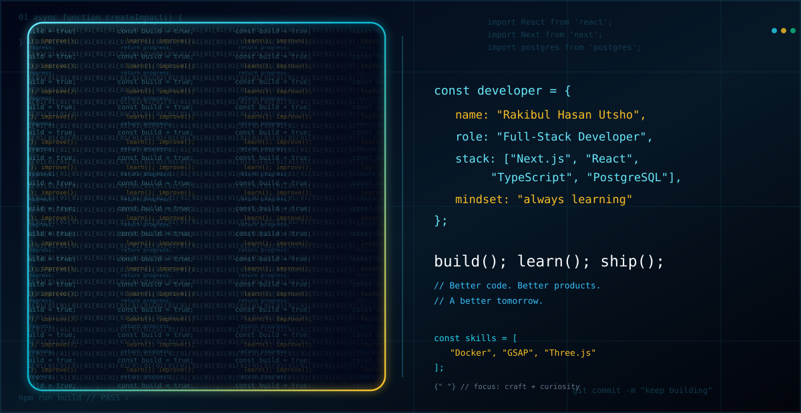

<!-- Top banner -->

  

  

  
  
  
  
  

  
  

  

<h2 align="center">👨‍💻 About me</h2>

  I'm <b>Rakibul Hasan Utsho</b>, a full-stack web developer who enjoys turning ideas into useful, reliable web products. 
  I mainly build with the <b>JavaScript/TypeScript ecosystem</b>, from modern React interfaces to API- and database-backed applications.

<table align="center">
  <tr>
    <td width="33%" valign="top">
      <h4>⚡ Frontend</h4>
      React, Next.js, TypeScript, Tailwind CSS, shadcn/ui and component-driven interfaces.
    </td>
    <td width="33%" valign="top">
      <h4>🧩 Backend</h4>
      Node.js, Express, REST APIs, validation, authentication and background jobs.
    </td>
    <td width="33%" valign="top">
      <h4>🗄️ Data</h4>
      MongoDB/Mongoose and PostgreSQL; exploring Redis-backed queues and reliable data flows through projects.
    </td>
  </tr>
  <tr>
    <td valign="top">
      <h4>🎞️ Motion &amp; UX</h4>
      Motion/Framer Motion and GSAP for purposeful interface animation.
    </td>
    <td valign="top">
      <h4>🧪 Engineering quality</h4>
      Type checking, automated tests, linting and production build checks.
    </td>
    <td valign="top">
      <h4>🌱 Mindset</h4>
      Learn by building, improve continuously, and write maintainable code.
    </td>
  </tr>
</table>

<h2 align="center">🧰 Tech stack</h2>

<table align="center">
  <tr>
    <th align="center">Frontend</th>
    <th align="center">Backend &amp; data</th>
    <th align="center">Tools &amp; deploy</th>
  </tr>
  <tr>
    <td align="center" valign="top">
      
    </td>
    <td align="center" valign="top">
      
    </td>
    <td align="center" valign="top">
      
    </td>
  </tr>
</table>

  
  
  
  
  
   
  
  
  
  
  
  

<h3 align="center">📚 Learning by building</h3>

<em>Technologies and practices I'm exploring through projects, not a claim that I've mastered every tool.</em>

<table align="center">
  <tr>
    <td width="50%" valign="top">
      <b>Modern full-stack patterns</b> 
      Next.js, React, TypeScript and reusable UI systems.
    </td>
    <td width="50%" valign="top">
      <b>Data and asynchronous work</b> 
      PostgreSQL, Redis and BullMQ alongside MongoDB-backed APIs.
    </td>
  </tr>
  <tr>
    <td valign="top">
      <b>Authentication and application security</b> 
      Passkeys/WebAuthn, session flows and safer API design.
    </td>
    <td valign="top">
      <b>Interactive UI and 3D</b> 
      Motion/Framer Motion, GSAP, Three.js and QR-based experiences.
    </td>
  </tr>
  <tr>
    <td valign="top">
      <b>Developer tooling</b> 
      Docker for reproducible development environments and container workflows.
    </td>
    <td valign="top">
      <b>Engineering discipline</b> 
      Automated tests, type checking, linting and production build validation.
    </td>
  </tr>
</table>

<h2 align="center">🚀 Selected projects</h2>

<table align="center">
  <tr>
    <td width="50%" valign="top">
      <h4>🏭 FactoryOS</h4>
      Manufacturing, inventory and production workflows, with a focus on traceability and reliable APIs.  
      
    </td>
    <td width="50%" valign="top">
      <h4>👛 Digital Wallet Backend</h4>
      TypeScript API services, authentication, validation and asynchronous job processing.  
      
    </td>
  </tr>
  <tr>
    <td valign="top">
      <h4>💳 Digital Payment System Web</h4>
      Next.js UI, passkey-ready authentication, QR flows and motion-rich experiences.  
      
    </td>
    <td valign="top">
      <h4>🗂️ Job Tracker Web</h4>
      Job tracking with a PostgreSQL-backed foundation and application quality checks.  
      
    </td>
  </tr>
  <tr>
    <td valign="top">
      <h4>🌍 3D Geospatial Platform</h4>
      3D geospatial data workflows, viewport performance and interactive visualization.  
      
    </td>
    <td valign="top">
      <h4>⏱️ TimeTorol — Next.js</h4>
      A modern React/Next.js application using TypeScript and UI motion.  
      
    </td>
  </tr>
</table>

  

<h2 align="center">📊 GitHub activity</h2>

  
  

  

  

<h3 align="center">🐍 Contribution snake</h3>

  <picture>
    <source media="(prefers-color-scheme: dark)" srcset="https://raw.githubusercontent.com/RakibulhasanUtsho07/RakibulhasanUtsho07/output/github-contribution-grid-snake-dark.svg" />
    <source media="(prefers-color-scheme: light)" srcset="https://raw.githubusercontent.com/RakibulhasanUtsho07/RakibulhasanUtsho07/output/github-contribution-grid-snake.svg" />
    
  </picture>

> The snake animation appears after the included GitHub Actions workflow completes successfully for the first time.

<h2 align="center">🤝 Connect with me</h2>

  
  
  
  

<em>“Keep learning, keep building, and make every commit count.”</em>

  

